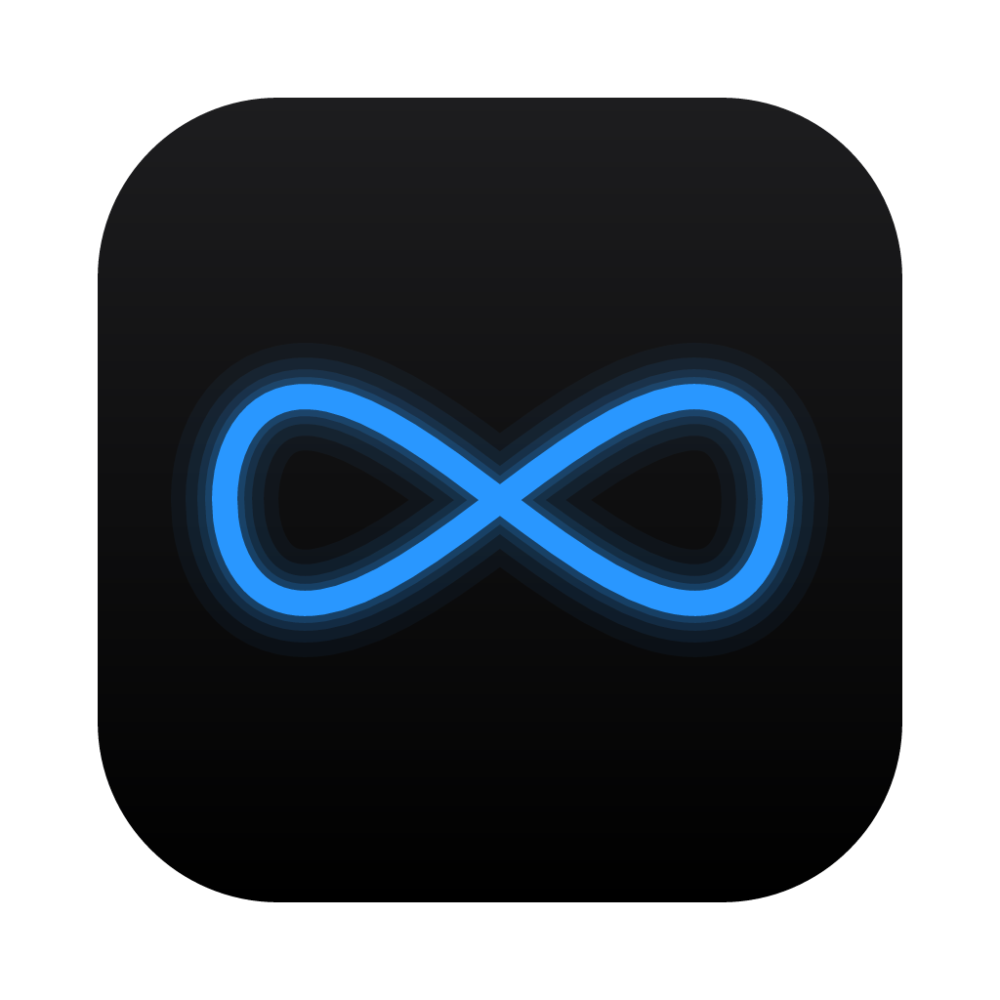
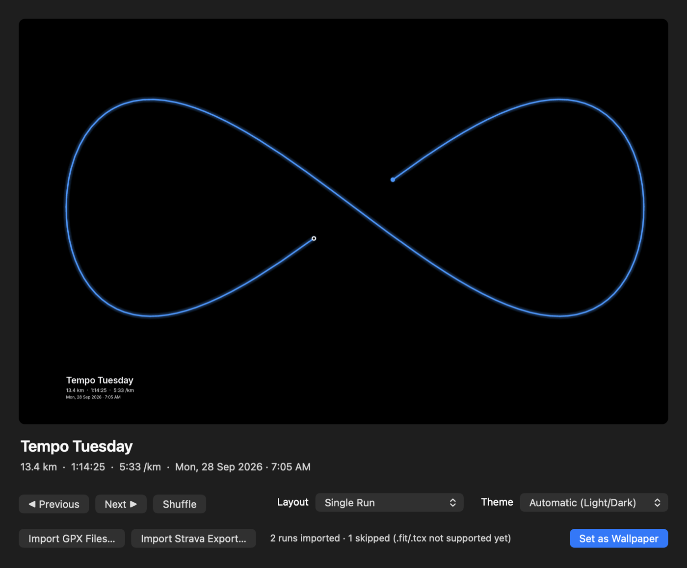

<p align="center">
  
</p>

<h1 align="center">RunReCap</h1>

<p align="center">Your past runs, drawn from GPX, as your Mac's wallpaper.<br><a href="https://azuanalias.com/RunReCap/">Website</a> · <a href="https://github.com/azuanalias92/RunReCap/releases/latest">Download</a></p>

<p align="center">
  
</p>

RunReCap turns the GPS tracks of your runs into a clean, minimal desktop wallpaper. Import your Strava export, pick a look, and your routes become the background of your Mac, optionally drawn over a photo of your own. It's a native macOS app written entirely in Rust.

## Features

- **Strava import.** Drop your Strava bulk export (`.zip`) or any `.gpx` / `.gpx.gz` files. Run names and types come from Strava, and duplicates are skipped.
- **Three layouts.**
  - **Single Run**: one route, large, with its name, distance, time, pace and date.
  - **Grid**: all your runs as small multiples.
  - **Heatmap**: every run in the area overlaid, so your favourite streets glow.
- **Themes.** Apple Dark, Apple Light and Mono Dark, or **Automatic** to follow your Mac's light/dark setting.
- **Your own photo.** Upload a background photo, and the route is drawn on top of it, with a Dim slider to keep it readable.
- **Route colors.** Solid, a start-to-finish gradient, or colored by pace, elevation, heart rate or time of day.
- **Any font.** Bundled Inter, any installed font, or your own `.ttf` / `.otf`.
- **Preview first.** Nothing on your desktop changes until you click **Set as Wallpaper**, and **Restore My Wallpaper** puts yours back.
- **Lives in the menu bar.** Change runs, layouts and themes from the menu bar, rotate to a new run every hour or day, and launch at login.
- **Multi-monitor aware.** Each display gets a wallpaper at its native resolution, kept clear of the menu bar, notch and Dock.
- **Privacy.** The first and last 200 m of every route are hidden, so your home isn't visible when you share your screen.
- **Automatic updates.** When a new version is out, click **Update to x.y.z** and the app reinstalls itself.

## Install

1. Download the latest `RunReCap-<version>.dmg` from [Releases](https://github.com/azuanalias92/RunReCap/releases).
2. Open it and drag **RunReCap** onto **Applications**.
3. Open RunReCap from Applications.

> **"Apple could not verify RunReCap…"** The app isn't notarized by Apple yet, so macOS asks you to confirm once:
> - **macOS 15 or later:** try to open it, click **Done**, then go to **System Settings → Privacy & Security** and click **Open Anyway**.
> - **macOS 13–14:** right-click (Control-click) RunReCap in Applications and choose **Open**.

**Requirements:** macOS 13 Ventura or later, on Apple Silicon or Intel.

## Getting started

1. **Get your runs.** On strava.com go to **Settings → My Account → Download or Delete Your Account → Request your archive**. Strava emails you a `.zip`, which can take a few hours. In the meantime, any `.gpx` file works.
2. **Import.** Drop the `.zip` or `.gpx` files on the preview, or click **Import Strava Export…** / **Import GPX Files…**.
3. **Pick a look.** Browse runs with **Previous / Next / Shuffle**, and choose a **Layout** and **Theme**.
4. **Click Set as Wallpaper.**

Closing the window keeps RunReCap in the menu bar. Choose **Open RunReCap** there to bring the window back.

## Background photo

Click **Choose Photo…**, or drop an image on the preview. Your runs are drawn on top of it.

| Your display | Recommended photo size |
|---|---|
| 13"/14" MacBook Air/Pro | 2880 × 1800 px or larger |
| 16" MacBook Pro | 3456 × 2234 px or larger |
| 4K external display | 3840 × 2160 px or larger |
| 5K (Studio Display, iMac 27") | 5120 × 2880 px or larger |

- The window shows the exact recommendation for the displays you have connected, and warns you if a photo is too small.
- Use a **landscape** photo. It's cropped to fill the screen, never stretched.
- JPEG, PNG, HEIC (iPhone photos), TIFF and WebP all work.
- Use **Dim** (0–70%) to darken busy photos so the route and text stand out.

## Customize

Most options are in the window and the menu bar. For more control (fonts, route colors, custom themes), choose **Open Settings File…** in the menu bar to edit `~/Library/Application Support/RunReCap/config.toml`. Changes apply within a minute.

```toml
theme = "Midnight"                 # a theme name, or "Automatic"
layout = "single"                  # single | grid | heatmap
units = "km"                       # km | mi
privacy_trim_m = 200               # metres hidden at the start/end of each route

[rotation]
every_minutes = 60                 # 0 = never
order = "newest"                   # newest | shuffle

[[themes]]
name = "Midnight"
background = { kind = "solid", color = "#000000" }

[themes.text]
font = { system = "Avenir Next", weight = 600 }   # or { bundled = "Inter" } / { file = "fonts/MyFont.otf" }
color = "#f5f5f7"
position = "bottom-left"           # bottom-left | bottom-center | bottom-right | top-left | top-right

[themes.route]
mode = "pace"                      # solid | gradient | pace | elevation | heart_rate | time_of_day
color = "#2997ff"
gradient = ["#2997ff", "#f5f5f7"]
```

## Command line

The app's binary also works as a CLI. None of these commands change your wallpaper.

```sh
R=/Applications/RunReCap.app/Contents/MacOS/runrecap
$R import ~/Downloads/export_12345.zip    # Strava export, .gpx files or folders
$R list                                   # runs in the library
$R themes                                 # available themes
$R render --layout grid -o grid.png       # render a wallpaper PNG
$R background ~/Pictures/beach.heic       # set a background photo (--clear to remove)
$R screens                                # displays as RunReCap sees them
$R update --check                         # check for a new version
```

## Build from source

You need [Rust](https://rustup.rs) and the Xcode Command Line Tools.

```sh
git clone https://github.com/azuanalias92/RunReCap.git
cd RunReCap
cargo run -p recap-app          # open the app
cargo test --workspace          # run the tests
packaging/make-dmg.sh           # build target/RunReCap-<version>.dmg
```

| Crate | What it does |
|---|---|
| `recap-core` | GPX parsing, Strava import, run library, geometry |
| `recap-render` | Layouts, themes, captions and fonts → pixels |
| `recap-macos` | Screens, wallpaper, image conversion, login item |
| `recap-app` | The app window, menu bar, updates and CLI |

[AGENTS.md](AGENTS.md) covers the architecture, conventions and roadmap, and [Design.md](Design.md) the visual design system.

## Releasing (maintainers)

```sh
# 1. bump [workspace.package] version in Cargo.toml
# 2. build the DMG and the update feed:
NOTES="What's new in this version" packaging/make-dmg.sh
# 3. create a GitHub release v<version> and upload BOTH:
#    target/RunReCap-<version>.dmg  and  target/latest.json
```

Installed copies check `releases/latest/download/latest.json` daily and offer the update. To ship a DMG that opens without the Gatekeeper prompt, sign and notarize it with a Developer ID:

```sh
xcrun notarytool store-credentials runrecap --apple-id you@example.com --team-id TEAMID --password <app-specific>
SIGN_ID="Developer ID Application: Your Name (TEAMID)" NOTARY_PROFILE=runrecap packaging/make-dmg.sh
```

## Privacy

RunReCap works entirely on your Mac. Your runs, photos and settings stay in `~/Library/Application Support/RunReCap/`. The only network request is the daily update check to GitHub.

## License

RunReCap is released under the [MIT License](LICENSE).

## Credits

Captions use the [Inter](https://rsms.me/inter/) typeface (SIL Open Font License 1.1), which is bundled under its own license (`assets/fonts/Inter-LICENSE.txt`).
